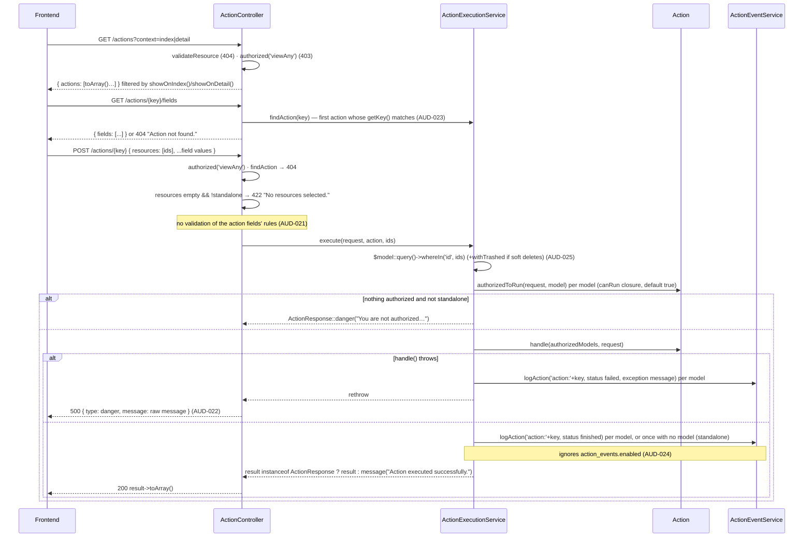

# Audit — Actions

Functional audit of resource actions (Nadota 1.3.0, 2026-11-02): lifecycle, authorization, events,
response contract, what is tested, and the issues found. Issues are described in full in
[`docs/testing/findings/audit.md`](../testing/findings/audit.md). HTTP tests for the action routes
belong to the OPS area (`tests/Feature/Http/Actions`); this audit adds unit tests for the base classes,
the controller (called directly) and the execution service.

## Purpose

Run custom code against selected records (or none, for standalone actions) from the index or detail
view, optionally collecting input first, and tell the frontend what to do next.

## Pieces

| Piece | File | Role |
|-------|------|------|
| Contract | `src/Contracts/ActionInterface.php` | key, name, handle, fields, authorizedToRun, show flags, texts, toArray (no `isStandalone`, AUD-026) |
| Base class | `src/Http/Actions/Action.php` | Defaults, fluent setters, serialization, static response helpers |
| Preset | `src/Http/Actions/DestructiveAction.php` | `destructive = true`, button `Delete`, default confirmation text |
| Response | `src/Http/Actions/ActionResponse.php` | Typed response (`message`, `danger`, `redirect`, `download`, `openInNewTab`) |
| Service | `src/Http/Services/ActionExecutionService.php` | Find, load models, authorize, run, log, normalise |
| Controller | `src/Http/Controllers/ActionController.php` | `index`, `fields`, `execute` |
| Routes | `routes/api.php:25-27` | `GET /actions`, `GET /actions/{actionKey}/fields`, `POST /actions/{actionKey}` |
| Logging | `src/Http/Services/ActionEventService.php`, `src/Events/ActionLogged.php`, `src/Jobs/LogActionEvent.php` | `action_events` rows and the `ActionLogged` event |

Actions also appear in `GET /{resourceKey}/resource/config` (index-visible ones, `ResourceIndexController.php:122-124`).

## Lifecycle



## Authorization

| Check | Where | Notes |
|-------|-------|-------|
| Resource key exists | controller constructor (`validateResource`, skipped in console) | 404 |
| Policy `viewAny` on the model | every controller method | 403; the only policy check |
| `canRun(fn (NadotaRequest $request, Model $model) => bool)` | `Action::authorizedToRun()` per loaded model | default: every model allowed. Unauthorized models are silently dropped |
| Per-model policy (`update`, `delete`, `runAction`…) | — | **not checked** — authorize inside `canRun()` |
| Resource query scoping (`getQuery()`/`queryIndex()`) | — | **bypassed**: any id can be targeted (AUD-025) |
| Standalone with selected-but-unauthorized models | service | runs `handle()` with an empty collection (the "nothing authorized" guard is skipped for standalone actions) |

Recommended until AUD-025 is fixed:

```php
DeleteForever::make()->canRun(fn (NadotaRequest $request, Model $model) =>
    $request->user()?->can('forceDelete', $model)
    && $model->school_id === $request->user()->school_id);   // re-apply tenant scoping
```

## Events and logging

- One `action_events` row per handled model, `name = "action:<key>"`, `actionable_type` = resource class,
  `status` `finished` or `failed` (with `exception` = message). A standalone run without models logs one
  row against `new $resource->model` with `model_id` null.
- `fields` = the whole request payload (`resources` included), sanitized by `action_events.exclude_fields`
  (when `track_fields` is on).
- `ActionLogged` is dispatched when `action_events.dispatch_events` is true; with `action_events.queue`
  the row is written by the `LogActionEvent` job and the returned event is an unsaved instance.
- `action_events.enabled = false` does **not** stop action logging (AUD-024).

## Response contract

`ActionResponse::toArray()` drops `null` values, `openInNewTab: false` and empty `data`:

| Factory | JSON |
|---------|------|
| `message($text)` | `{ "type": "message", "message": "…" }` |
| `danger($text)` | `{ "type": "danger", "message": "…" }` |
| `redirect($url)` | `{ "type": "redirect", "url": "…" }` |
| `download($url, $name)` | `{ "type": "download", "url": "…", "filename": "…" }` |
| `openInNewTab($url)` | `{ "type": "openInNewTab", "url": "…", "openInNewTab": true }` |
| `->withData([...])` | adds `"data": {…}` (merged across calls, later keys win) |
| `new ActionResponse('custom')` | `{ "type": "custom" }` — any type string is accepted |

All factories are mirrored as static helpers on `Action` (`Action::message()` …).

HTTP status: 200 for every `ActionResponse` (including `danger`), 404 unknown key, 422 no resources, 500
for any `\Exception` from `execute()` (AUD-022), 403 from `viewAny`.

## Action definition (serialized shape)

`Action::toArray($request)`:

```json
{
  "key": "activate-students",
  "name": "Activate Students",
  "fields": [ { "key": "reason", "type": "textarea", "…": "…" } ],
  "showOnIndex": true,
  "showOnDetail": true,
  "destructive": false,
  "standalone": false,
  "confirmText": null,
  "confirmButtonText": "Run Action",
  "cancelButtonText": "Cancel"
}
```

`component` and `icon` are added only when set. `DestructiveAction` changes `destructive` → `true`,
`confirmButtonText` → `Delete`, `confirmText` → `Are you sure you want to run this action?`.

| API | Default | Notes |
|-----|---------|-------|
| `getKey()` | `Helpers::toUri(static::class)` | pluralised basename: `SendReminder` → `send-reminders` (AUD-023) |
| `name()` | `$name` ?? `Str::headline(class_basename())` | |
| `onlyOnIndex()` / `onlyOnDetail()` / `showOnTableRow()` | both shown | `showOnTableRow()` = index + detail (AUD-027) |
| `destructive(bool)`, `standalone(bool)` | false | |
| `withConfirmation()`, `setConfirmButtonText()`, `setCancelButtonText()` | `null`, `Run Action`, `Cancel` | |
| `component()`, `icon()` | `null` | omitted from JSON when null |
| `canRun(Closure)` | allow all | receives `(NadotaRequest, Model)` |
| `fields()` | `[]` | serialized with each field's `toArray()`; rules are **not** enforced (AUD-021) |
| `make()` | `new static()` | no constructor arguments (AUD-027) |

## Extension points

```php
class ExportRoster extends Action
{
    protected ?string $name = 'Export roster';

    public function fields(NadotaRequest $request): array
    {
        return [Select::make('Format', 'format')->options(['pdf' => 'PDF', 'csv' => 'CSV'])->rules(['required'])];
    }

    public function handle(Collection $models, NadotaRequest $request): mixed
    {
        // Validate yourself until AUD-021 is fixed — and do not throw ValidationException (AUD-022):
        $data = validator($request->all(), ['format' => 'required|in:pdf,csv'])->validate();

        $url = RosterExporter::make($models, $data['format'])->store();

        return Action::download($url, "roster.{$data['format']}")->withData(['rows' => $models->count()]);
    }
}

// on the resource
public function actions(NadotaRequest $request): array
{
    return [
        ExportRoster::make()->onlyOnIndex()->icon('Download')
            ->canRun(fn ($request, $model) => $request->user()->can('view', $model)),
        ImportRoster::make()->standalone()->component('ActionImportWizard'),
    ];
}
```

`ActionExecutionService::executeBatched()` (chunks of 100, per-batch logging) is available for custom
controllers; no route uses it.

## Test coverage

| Behaviour | Test |
|-----------|------|
| `toArray()` keys and defaults, fields serialization, optional `component`/`icon`, name fallback, visibility toggles, destructive/standalone, confirm texts, `canRun`/`authorizedToRun`, `make()`, static helpers | `tests/Unit/Actions/ActionTest.php` |
| Key pluralisation and collision (AUD-023) | same file, skipped |
| `DestructiveAction` presets, subclass overrides, fluent overrides | `tests/Unit/Actions/DestructiveActionTest.php` |
| Every `ActionResponse` type, `withData()` merging, null filtering, custom type, `Arrayable`/`JsonSerializable` | `tests/Unit/Actions/ActionResponseTest.php` |
| Controller: context filter, 403 `viewAny`, fields + 404, execute 404 / 422 / standalone / 500 | `tests/Unit/Actions/ActionControllerTest.php` |
| Validation of field rules (AUD-021), `ValidationException`/`HttpException` status (AUD-022) | same file, skipped |
| Service: `canRun` filtering, danger when none authorized, standalone, default message, trashed models | `tests/Unit/Actions/ActionExecutionTest.php` |
| Tracking switch (AUD-024), custom primary key and query scoping (AUD-025) | same file, skipped |
| Logging per model / failed / standalone / batched (pre-existing) | `tests/Unit/Services/ActionExecutionServiceTest.php` |
| HTTP routes | OPS area: `tests/Feature/Http/Actions/` |

Fixtures: `tests/Fixtures/Actions/SendReminder.php` (singular name, required/max field, records the input
it received) and `SendReminders.php` (plural twin for the key collision), next to the existing
`ActivateStudents` and `PurgeInactiveStudents`.

## Issues

| ID | Summary | Severity |
|----|---------|----------|
| [AUD-021](../testing/findings/audit.md#aud-021--action-field-rules-are-never-validated) | Action field rules never validated | high |
| [AUD-022](../testing/findings/audit.md#aud-022--actioncontroller-turns-every-exception-into-a-500-with-the-raw-message) | Every exception becomes a 500 with the raw message | medium |
| [AUD-023](../testing/findings/audit.md#aud-023--action-keys-are-pluralised-and-can-collide-docs-describe-fqcn-keys) | Pluralised, colliding keys; docs describe FQCN keys | low |
| [AUD-024](../testing/findings/audit.md#aud-024--action-runs-are-logged-even-with-action_eventsenabled--false) | Logged even with tracking disabled | medium |
| [AUD-025](../testing/findings/audit.md#aud-025--action-targets-are-loaded-by-raw-id-bypassing-the-key-name-and-getquery-scoping) | Raw `id` lookup bypasses key name and scoping | high |
| [AUD-026](../testing/findings/audit.md#aud-026--actioninterface-misses-methods-the-service-and-controller-call) | `ActionInterface` incomplete | low |
| [AUD-027](../testing/findings/audit.md#aud-027--action-api-naming-doubts) | Naming doubts (`showOnTableRow`, `make()`, `executeBatched`) | low |

### Doc contradictions in `docs/guides/actions.md`

- Keys are described as FQCN slugs (`app-nadota-actions-activate-users`); they are pluralised basenames (AUD-023).
- "Validation is driven by the field's own `rules()`" — nothing validates (AUD-021).
- "Unexpected exceptions are caught and returned as 500" is accurate but also applies to validation and
  HTTP exceptions, which the guide does not warn about (AUD-022).
